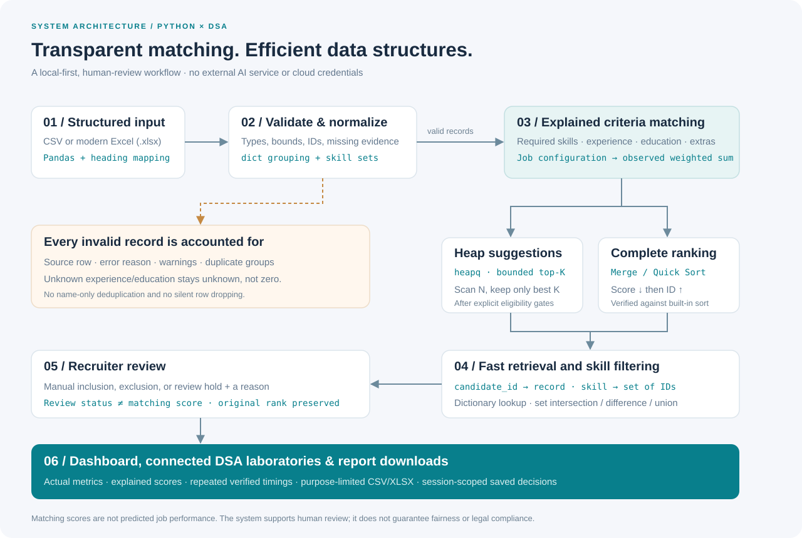
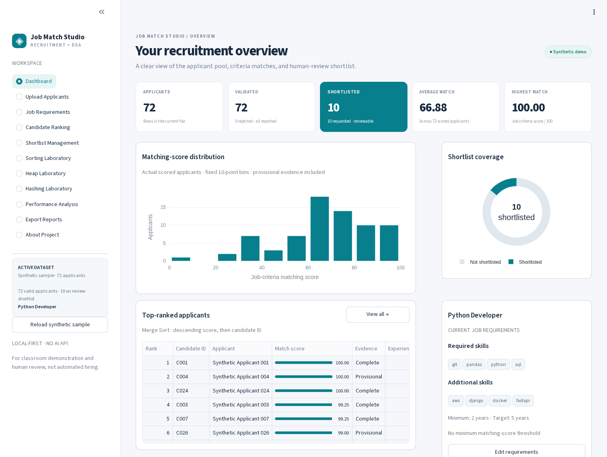
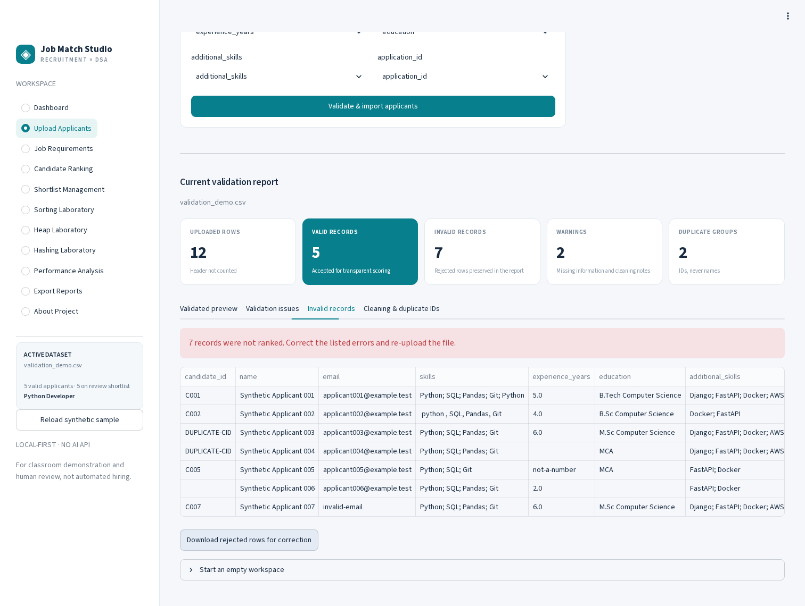
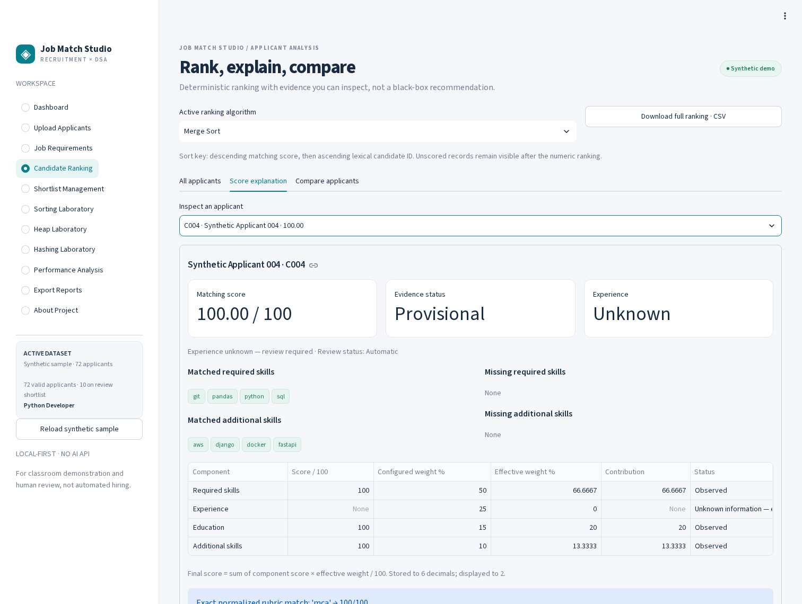
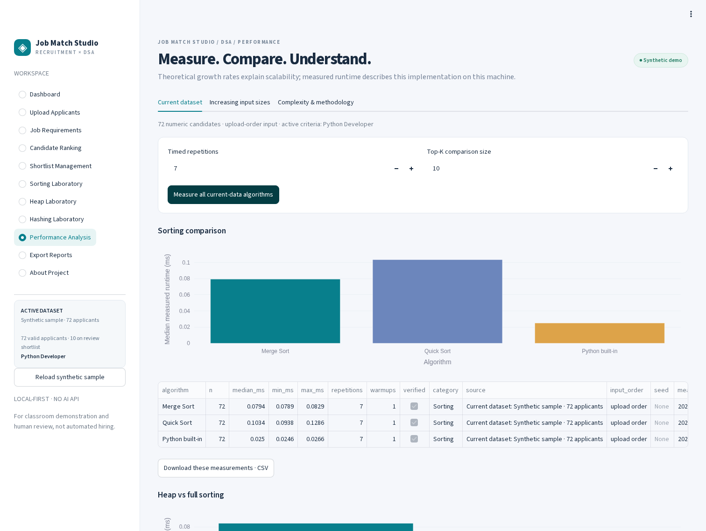

# Intelligent Job Applicant Ranking and Shortlisting System Using Python and Data Structures and Algorithms

**Application name:** Job Match Studio  
**Course:** Data Structures and Algorithms with Python · B.Tech mini project  
**Core:** genuine Merge Sort, partition-based Quick Sort, bounded `heapq` top-K selection, and real `dict`/`set` hashing.

This is a working, modular application—not a static dashboard or an AI API wrapper. It ships with 72 synthetic applicants, automated tests, a modern Streamlit interface, actual algorithm benchmarks, CSV/Excel reports, and real application screenshots.

> **Purpose and safeguards:** scores measure matches to recruiter-defined **job criteria**, not predicted job performance. The system supports human review; it does not make hiring decisions or guarantee unbiased or legally compliant hiring. Names and contact details are not scoring features. Protected or irrelevant source columns are excluded from scoring and standard exports.

## Quick start on Windows

Extract the project ZIP, open a terminal in the directory containing the extracted project folder, then run:

```bat
cd intelligent-job-ranking
python -m venv .venv
.venv\Scripts\activate
python -m pip install --upgrade pip
python -m pip install -r requirements.txt
python -m streamlit run app.py
```

Open **http://localhost:8501** if a browser does not open automatically. The application loads the actual synthetic sample file on first use; no upload is needed for an initial demonstration.

```bat
python -m pytest -v
```

**Verified delivery:** 252 automated test cases passed in the supplied Linux/Python 3.13 environment. Live Chromium verification also covered real CSV/Excel uploads, manual heading mapping, downloaded reports, all 11 pages, and a 390-pixel mobile viewport. See [test output](docs/test_results.txt) and [browser verification](docs/browser_verification.txt). Windows-compatible instructions are supplied; a native Windows machine was not available for execution verification.

---

## 1. Abstract

Recruiters often need to review many applicants against a specific role. This mini project converts structured applicant data into transparent criteria-matching scores, deterministic rankings, and a reviewable shortlist. Pandas handles tabular input and validation; dictionaries and sets normalize and index skills, detect duplicate identifiers, and support fast retrieval. Merge Sort and Quick Sort generate complete rankings. A bounded heap selects the best K eligible applicants without first sorting all N applicants. Streamlit makes these operations visible through recruitment analytics, score explanations, laboratories, benchmarks, and downloadable reports. No external AI model, paid API, cloud account, or internet connection is needed for the installed application's core workflow.

## 2. Problem statement

Manual spreadsheet review becomes inconsistent and time-consuming as the applicant pool grows. Recruiters need a repeatable way to match explicitly defined job criteria, understand missing evidence, inspect ties, revise review decisions, and share a shortlist. Students also need to see why different data structures suit different operations rather than learning sorting, heaps, and hashing as isolated exercises.

The problem is **criteria matching and review organization**, not an attempt to estimate a person's overall ability or future performance.

## 3. Objectives

1. Accept structured CSV and modern Excel input with understandable error reports.
2. Normalize skills and compute explained, bounded, deterministic matching scores.
3. Implement and verify genuine Merge Sort and Quick Sort against a built-in baseline.
4. Use `heapq` for streaming-style top-K selection with deterministic ties.
5. Use dictionary/set hashing for identity lookup, skill filters, and duplicate detection.
6. Preserve every rejected row in a validation report and every unscored valid applicant in the review workflow.
7. Keep scores separate from manual shortlist decisions and notes.
8. Benchmark equivalent inputs honestly and distinguish timing observations from Big-O.
9. Produce useful, purpose-limited CSV/Excel reports.
10. Deliver understandable modules, automated tests, and presentation documentation.

## 4. Existing-system limitations

- Manual review can apply job criteria inconsistently and makes score explanations difficult.
- Name-only deduplication can confuse different people with the same name.
- Full sorting does unnecessary work when only a small top-K subset is needed.
- Repeated linear scans are inefficient for ID retrieval and skill searches.
- Missing values are often silently imputed, dropped, or confused with zero.
- Static dashboards cannot respond to changed requirements or actual uploads.
- Opaque AI recommendations can obscure the relationship between evidence and score.

These are design motivations, not claims about every commercial recruitment product.

## 5. Proposed system

Job Match Studio offers one session-scoped workspace. A recruiter imports a file, maps headings, checks validation, configures job-related criteria and weights, and inspects an explained ranking. The system produces heap-based suggestions and lets a human include, exclude, or hold candidates with reasons. Separate laboratories run the same algorithms and ranking keys on the current applicant records. Generated experiments show scaling without contaminating recruitment metrics. All reports are generated from actual data and saved decisions.

### Functional requirements / application pages

| Page | Working features |
|---|---|
| Dashboard | Uploaded/valid/review-shortlisted counts, actual average and maximum scores, ten score bins (including exact 100), top applicants, shortlist chart, current criteria and evidence flags |
| Upload Applicants | CSV/`.xlsx`, preview, alias suggestions and manual mapping, row errors/warnings, rejected rows, cleaning counts, duplicate reports, sample download and explicit data reset |
| Job Requirements | Title, normalized required/additional skills, minimum/target experience, editable education rubric, four weights, K and optional threshold; atomic validation and recalculation |
| Candidate Ranking | Select genuine ranking algorithm, search/filter, unknown-experience toggle, full explanations, compare two to five candidates, ranking CSV |
| Shortlist Management | Heap suggestions, minimum/threshold policy, manual inclusion/exclusion/review hold with mandatory reason, reset decisions, shortlist CSV |
| Sorting Laboratory | Run selected algorithm, see real ranked output, verify reference agreement, repeated timing comparison and generated-size experiments |
| Heap Laboratory | Interactive K including zero and N+ values, optional eligibility gates, exact top-K verification and measured comparison to full sorting |
| Hashing Laboratory | ID retrieval, all/any skill filtering using sets, matched/missing skills, inverted-index inspection, duplicate reports and dictionary/linear timing |
| Performance Analysis | Current-data suite, seeded increasing-size sorting/heap/hash experiments, plots, medians/min/max, correctness and theoretical complexity |
| Export Reports | Ranked list, review shortlist, component explanations, validation workbook and executed benchmark reports as CSV/Excel |
| About Project | Architecture, DSA explanations, scoring safeguards, faculty demonstration and scope limits |

### Non-functional requirements

- **Determinism:** score stored to six decimals; rank descending score then ascending lexical candidate ID.
- **Correctness:** built-in reference verification and automated tests cover boundary conditions and full workflows.
- **Transparency:** all component scores, exclusions, effective weights, missing evidence, gates and review reasons are inspectable.
- **Modularity:** UI functions do not duplicate business logic; the pipeline is usable independently of Streamlit.
- **Portability:** Python 3.11+, standard file paths, modern OOXML Excel, no Docker/WSL/cloud dependency.
- **Offline operation:** installed packages and local files suffice; Plotly/Streamlit resources are served by the local application.
- **Input safety:** strict parsing, 20 MB uploads, numeric bounds, ambiguous-ID rejection, spreadsheet formula-prefix escaping on export.
- **Privacy-conscious reporting:** standard analytics exclude email and arbitrary input columns. Use synthetic data for classroom presentations.
- **Usability:** consistent dashboard styling, navigable empty states, form errors and explicit saved-review semantics.
- **Session continuity:** ordinary sidebar navigation preserves imported data, saved requirements, rankings, decisions and executed benchmarks.

## 6. Technology stack

| Technology | Role |
|---|---|
| Python 3.11 or compatible newer version | Algorithms, validation, scoring and orchestration |
| Pandas | CSV/Excel input, validation/report tables |
| Streamlit 1.52+ | Interactive local UI and browser-session state |
| `heapq` | Bounded heap for best K |
| `dict`, `set`, `frozenset` | ID maps, inverted indexes, intersections and duplicate grouping |
| `time.perf_counter` + `statistics` | Actual repeated timings and medians |
| Plotly | Data-derived dashboard and measured performance charts |
| OpenPyXL | Modern Excel reading and styled report workbooks |
| Pytest + Streamlit AppTest | Unit, workflow, export, benchmark and UI tests |

Dependencies are in `requirements.txt`. The tested top-level versions are recorded in `docs/environment.txt`; dependency installation may require internet once. Running the core app does not require internet or credentials. Playwright was used separately to verify the supplied build, not as an application dependency.

## 7. System architecture



```text
                     Recruiter-defined job requirements
                                      |
CSV / XLSX → column mapping → row validation → normalized valid records
                                  |                   |
                      rejected rows / issues      scoring + explanations
                                                      |
                                   +------------------+------------------+
                                   |                                     |
                          eligible heap top-K                  Merge / Quick / built-in
                          suggested shortlist                  complete numeric ranking
                                   +------------------+------------------+
                                                      |
                                          ID dictionary + skill sets
                                                      |
                                    saved human statuses / notes (separate)
                                                      |
                                      dashboard / labs / CSV & XLSX reports
```

### Module responsibilities

- `core/data_loader.py`: parsing, file bounds and source-heading mapping.
- `core/data_validation.py`: row validation, complete rejection/warning reports, duplicate grouping.
- `core/normalization.py`: canonical skill/education/identifier helpers.
- `core/scoring.py`: validated job configuration and transparent scoring.
- `core/ranking.py`: public reusable service; reference verification and indexes.
- `core/shortlisting.py`: real heap suggestions and independent review overrides.
- `core/analytics.py`: actual score-bin counts, including the 100 boundary.
- `algorithms/`: genuine algorithms and hashing operations.
- `utils/`: measured performance and safe CSV/Excel generation.
- `ui/`: focused pages, reusable components, and session-state orchestration.
- `app.py`: a small entry point and navigation router—not a giant business-logic file.

### Data flow and saved-state behavior

1. Read a UTF-8 CSV or first worksheet of a modern `.xlsx`; never skip parser errors.
2. Suggest aliases, or let the user choose a unique source column for each field.
3. Validate every input row. Required headings are `candidate_id`, `name`, `skills`.
4. Report every invalid record and source row; validate optional supplied values too.
5. Normalize text and retain unknown experience/education as `None`.
6. Compute explanations for each valid record.
7. Heap-select numeric, eligible suggestions **before** constructing the complete ranking.
8. Rank numeric records with the selected algorithm and check the reference; put unscored records last with no invented rank.
9. Build ID/skill indexes over all valid records.
10. Apply/save recruiter decisions without changing original scores or ordinal ranks.
11. Export the current state; ordinary page navigation does not reset it.

New dataset imports reset dataset-specific decisions to prevent reusing notes for a different person with the same ID. Job changes retain decisions and explicitly ask the recruiter to review them against the new criteria. Current-data measurements and lab outputs are invalidated when data/criteria change. Generated algorithm-only measurements stay separately labelled. Browser refresh, a new session, or server restart may reset session memory; download reports before closing.

## 8. Applicant dataset and validation policy

### Schema

| Field | Required heading? | Value policy |
|---|---|---|
| `candidate_id` | Yes | Nonblank, case-sensitive unique ID; 1–64 letters/digits/dot/underscore/hyphen, starting with letter/digit |
| `name` | Yes | Nonblank text; display/contact identification only, never a score input |
| `skills` | Yes | Text or supported string collection; blank is a reported empty set, not an invalid row |
| `email` | No | Blank is allowed; a supplied value must have basic email syntax; never scored |
| `experience_years` | No | Blank stays unknown; otherwise finite numeric 0–80, fractional years allowed |
| `education` | No | Blank stays unknown; otherwise text, normalized for exact rubric matching |
| `additional_skills` | No | Blank is an explicitly reported empty set |
| `application_id` | No | Supplied IDs follow the ID syntax and must be unique; missing IDs are generated and reported |

Missing cells include blanks, scalar NaN/None, and text `n/a`, `null`, `none`, `nan` (case-insensitive). Skill separators are comma, semicolon, pipe or newline; internal multi-word skill names remain intact.

- Identifiers are trimmed but not lowercased. Tie ordering is **lexical** (`C10` precedes `C2`), not a natural-number sort.
- Textual leading zeros survive CSV input; Excel numeric cells cannot recover zeros that were already lost by Excel. Store such IDs as text.
- Missing application IDs normally become `APP-<candidate_id>`. For a candidate ID longer than 60 characters, a deterministic SHA-256-derived suffix keeps the generated application ID within 64 characters. The generation is logged; this is not a custom hash-table implementation.
- **Every row** in a repeated candidate-ID or application-ID group is rejected, not just later occurrences. This avoids arbitrary overwriting. Resolve all duplicates before re-uploading.
- Matching names are never sufficient to identify duplicates.
- Optional fields being absent do not discard otherwise valid records. Optional fields that are supplied with invalid types/values produce specific errors.
- Extra/unmapped fields do not affect scoring or standard exports.
- Source-row numbers start at 2 (header is row 1); multiline CSV records are numbered by logical data row, not physical text-line count.
- A schema-only empty table is supported. An empty file without a header is a clear load error.
- Repeated literal source headings in CSV/Excel are rejected; ambiguous mappings are not allowed.

### Sample format

```csv
candidate_id,name,email,skills,experience_years,education,additional_skills,application_id
C001,Synthetic Applicant 001,applicant001@example.test,Python; SQL; Pandas; Git,5,B.Tech Computer Science,Django; FastAPI; Docker; AWS,A0001
C004,Synthetic Applicant 004,applicant004@example.test,Python; SQL; Pandas; Git,,MCA,Django; FastAPI; Docker; AWS,A0004
```

- `data/sample_applicants.csv`: **72 synthetic records**, all valid; optional blanks are intentional evidence examples.
- `data/sample_applicants.xlsx`: the same sample in modern Excel format.
- `data/validation_demo.csv`: **12 synthetic records**, deliberately producing 5 valid and 7 invalid records, including two duplicate-ID groups and malformed supplied values.
- All names are synthetic numbered labels; emails use reserved `example.test` addresses. No real personal information is included.

## 9. Candidate scoring formula and missing evidence

### Components (each 0–100)

Let `C` be the union of a candidate's normalized `skills` and `additional_skills`.

```text
Required skills score  = 100 × |C ∩ configured_required| / |configured_required|
Experience score       = 100 × min(known_experience / target_experience, 1)
Education score        = exact normalized education-rubric value,
                         or the configured unmatched-label score for PROVIDED education
Additional skills score= 100 × |C ∩ configured_additional| / |configured_additional|
```

The required and additional job lists must not overlap. A candidate skill can be supplied in either input skill column. No fuzzy synonyms, semantic inference, degree inference, or AI extraction is used.

Configured weights must sum to **100%** (floating-point comparison tolerance `1e-8`). Disabled job components are excluded. For candidate `c`, let `A(c)` be configured, observed, positive-weight components:

```text
Effective weight_i(c) = 100 × configured_weight_i / Σ configured_weight_j for j in A(c)
Final matching score = Σ [component_score_i(c) × Effective weight_i(c) / 100] for i in A(c)
```

This is a weighted **sum**, not a multiplication of four component products. Scores are clamped to 0–100 and stored to six decimals; the UI displays two decimals and sorts the stored values.

### Example Python Developer configuration

- Required: Python, SQL, Pandas, Git.
- Additional: Django, FastAPI, Docker, AWS.
- Minimum experience: 2 years; target: 5 years.
- Weights: required 50%, experience 25%, education 15%, additional 10%.
- K: 10; no score threshold unless configured.

Example editable, job-related education rubric:

| Exact normalized label | Score |
|---|---:|
| b.tech computer science | 100 |
| b.e. computer science | 100 |
| mca | 100 |
| m.sc computer science | 95 |
| b.sc computer science | 85 |
| diploma computer science | 60 |
| Other PROVIDED label | Configured default, initially 0 |

This is an **example for the configured role**, not a universal education hierarchy. Recruiters can edit the entire rubric or disable education scoring.

A candidate with Python + SQL, two years of experience, B.Sc Computer Science and Docker has component scores 50, 40, 85, 25. With the example weights:

```text
Final = 50×0.50 + 40×0.25 + 85×0.15 + 25×0.10 = 50.25
```

### Explicit missing-data policy

- Missing experience/education has a **None/unavailable component**, never an invented zero.
- Remaining observed weights are renormalized. If a positively weighted configured component is unknown, the score is **Provisional**, with visible warnings and exact effective weights.
- A missing job component is **Not configured—excluded**, not a candidate failure.
- If all weighted evidence is unavailable, the valid candidate is retained as **Unscored**, with no numeric rank and no automatic suggestion.
- Blank skill cells are warned about and interpreted as explicitly reported empty skill sets. A skill not supplied is not assumed matched.
- Provisional scores can look high despite incomplete evidence. They are not directly comparable with fully evidenced scores and require human review. Sample `C004` demonstrates this deliberately.
- Known experience below the configured minimum is excluded from **automatic** suggestions with an explicit reason, but remains ranked and manually reviewable.
- Unknown experience cannot verify the minimum: it remains available for a suggested review shortlist, clearly flagged **Experience unknown—review required**. It is not silently rejected or described as satisfying the minimum.

Every explanation includes matched/missing required and additional skills, component scores/statuses, configured/effective weights, contributions, education reasoning, final score, evidence flags and shortlist assessment. See [scoring policy notes](docs/scoring_policy.md).

## 10. Ranking and review shortlist semantics

**Ranking contract:** descending finite `final_score`, then ascending string `candidate_id`. Standalone algorithms allow negative scores as algorithm exercises; the production scoring engine does not produce them. Identical score+ID keys in standalone calls retain source order. Candidate dictionaries and the caller's list are not modified.

**Automatic suggestions:** apply known-minimum-experience and optional score gates, then genuinely scan the eligible stream with a bounded heap. K=0 suggests none; K>N returns at most the number eligible; tied scores use the same ID ordering as full sorting.

**Separate review statuses:**

| Status | Effect |
|---|---|
| Automatic | Follow the heap-generated suggestion; not a claim of completed human review |
| Shortlisted | Explicit manual inclusion; reason required; can bypass gates, include unscored records or exceed K |
| Not shortlisted | Explicit manual exclusion; reason required |
| Needs review | Hold for evidence review, not on the final review shortlist; reason required |

Manual exclusions/holds do not automatically refill freed places: the original suggestion and human action remain distinct. Raise K or record another inclusion explicitly if needed.

The matching score and ordinal rank never change because of these statuses. `suggested_shortlist`, `is_shortlisted`, `review_status`, `review_note`, source and reason remain separate fields. A final review shortlist is not a hiring approval.

## 11. DSA concepts and algorithm pseudocode

### Merge Sort — `algorithms/sorting.py`

The implementation uses bottom-up divide-and-conquer merging. Singleton runs form base subproblems, and each pass merges them into runs of double the width. No `sorted()` wrapper is hidden inside it.

```text
MERGE_SORT(records)
    copy/key the records
    width ← 1
    while width < N
        for every pair of adjacent runs of length width
            compare each run's next key
            copy the better item to merge workspace
            copy remaining items from either run
        swap source and workspace
        width ← 2 × width
    return ordered candidate references
```

### Quick Sort — `algorithms/sorting.py`

A median-of-three pivot reduces common ordered-input pathologies. Real three-way partitioning separates keys less than/equal to/greater than the pivot. An explicit stack processes the smaller partition first, avoiding recursion-depth failure. Original positions decorate keys to preserve same-ID tie order. Worst-case quadratic time is **not** claimed to disappear.

```text
QUICK_SORT(records)
    decorate keys with original positions, copy records
    pending ← [(0, N−1)]
    while pending is not empty
        take a partition [lo, hi]
        while lo < hi
            pivot ← median(key[lo], key[mid], key[hi])
            partition into < pivot, = pivot, > pivot
            push the larger nontrivial partition
            continue immediately with the smaller partition
    return ordered candidate references
```

### Bounded heap — `algorithms/heap_ranking.py`

A custom comparison **entry**, not a custom hash function, reverses the rank key so the worst retained candidate is the min-heap root. Comparisons use only numeric/string keys and input position. Candidate dictionaries are never compared.

```text
TOP_K(stream, K)
    reject negative, boolean, or noninteger K
    if K = 0: return []
    heap ← empty
    for each candidate in the original stream
        entry ← reversed rank key + unique input position
        if heap has fewer than K entries
            heappush(heap, entry)
        else if entry ranks better than heap root
            heapreplace(heap, entry)
    rank ONLY the retained heap entries
    return those K candidates
```

A heap is preferable for small K, a stream, or only a top subset. Full sorting is preferable for the entire ranked list or many arbitrary rank queries. An optimized built-in sort can still win on real timings; the UI does not assume a universal fastest method.

### Hashing — `algorithms/hashing.py`

```text
BUILD_INDEX(records)
    candidates_by_id ← dictionary
    skill_to_ids ← dictionary of sets
    for each valid candidate
        reject any duplicate candidate key
        candidates_by_id[id] ← record
        for each normalized candidate skill
            add id to skill_to_ids[skill]

GET_CANDIDATE(id) = candidates_by_id.get(id)
MATCHED = candidate_skill_set ∩ required_skill_set
MISSING = required_skill_set − candidate_skill_set
ALL_SKILLS_FILTER = intersection of requested skill buckets
ANY_SKILL_FILTER = union of requested skill buckets

DUPLICATES(records, field)
    group every record position by its nonblank identifier in a dictionary
    return every identifier group containing more than one position
```

The same hash-based duplicate grouping is used by actual validation, not an unrelated toy demonstration. A custom hash table was optional and is intentionally omitted in favor of built-in dictionaries and sets.

## 12. Theoretical time and space complexity

N = candidates, K = retained candidates, T = total stored skill tokens, S/R = candidate/required skills, M = returned IDs. The table assumes bounded-length keys; hashing/processing long text also costs character-processing time.

| Operation | Best time | Average time | Worst time | Additional working space |
|---|---|---|---|---|
| Bottom-up Merge Sort | O(N log N) | O(N log N) | O(N log N) | O(N) merge/key workspace |
| Iterative Quick Sort | O(N log N) | O(N log N) | O(N²) | O(N) copied/decorated records + O(log N) pending stack |
| Python Timsort baseline | O(N) | O(N log N) | O(N log N) | O(N) |
| Heap top-K, 1<K≤N | O(N + K log K) | O(N log K + K log K) | O(N log K + K log K) | O(K), excluding input/final output |
| ID dictionary lookup | O(1) | O(1) | O(N) | O(N) stored index; O(1) per query |
| Inverted skill bucket returned | O(1+M) | O(1+M) | O(T+M) | O(N+T) index; O(M) returned copy |
| Normalize and match skill sets | O(S+R) | O(S+R) | O((S+R)²) with pathological collisions | O(S+R) |
| Duplicate-ID hash grouping | O(N) | O(N) | O(N²) with pathological collisions | O(N) |
| Linear candidate lookup | O(1) | O(N) | O(N) | O(1) per query |

Heap final output sorting costs O(K log K), included above; this is conventionally summarized as O(N log K) when 1<K≤N. K=1 costs O(N); K=0 returns in O(1) without consuming a stream; K>N retains at most N. All three complete sorting functions allocate a new result and do not mutate caller records. The **whole application** stores O(N) candidate data and indexes; the heap's O(K) claim applies to the selection algorithm, not to the entire dashboard.

## 13. Benchmark methodology

- Current-data experiments use **the actual numeric applicant records in original upload order**.
- Generated experiments use seeded algorithm-only records under the same score/ID contract; they never contribute to recruitment metrics or shortlists.
- Each method receives equivalent inputs, one warm-up, and repeated actual `perf_counter` measurements. Method order rotates between repetitions.
- Reports contain median/min/max milliseconds, repetition count, N, K where applicable, input order, seed, source, correctness, timestamp, Python version and platform.
- Loading, generation, scoring, baseline generation and correctness checks are outside the timed region. Key extraction, allocations and algorithm work are inside.
- Every warm-up and timed result must match the reference. A mismatch raises a visible error rather than publishing a success.
- Hash tests use identical seeded batches of hits/misses. Index build time is separately measured; per-query latency is derived from batch median timing.
- Big-O is theoretical. Python/C implementation constants, input order, K/N, allocation, CPU load and timer overhead affect observations.
- The project does **not** fabricate benchmark values, infer universal winners, or claim empirical peak-memory measurements. No decorative theoretical curves are presented as measured data.

## 14. Project folder structure

```text
intelligent-job-ranking/
├── app.py
├── algorithms/
│   ├── __init__.py
│   ├── sorting.py
│   ├── heap_ranking.py
│   └── hashing.py
├── core/
│   ├── __init__.py
│   ├── data_loader.py
│   ├── data_validation.py
│   ├── normalization.py
│   ├── scoring.py
│   ├── ranking.py
│   ├── shortlisting.py
│   └── analytics.py
├── utils/
│   ├── __init__.py
│   ├── exports.py
│   └── performance.py
├── ui/
│   ├── __init__.py
│   ├── components.py
│   ├── state.py
│   ├── pages_dashboard.py
│   ├── pages_upload.py
│   ├── pages_requirements.py
│   ├── pages_candidates.py
│   ├── pages_labs.py
│   ├── pages_performance.py
│   ├── pages_reports.py
│   └── pages_about.py
├── data/
│   ├── sample_applicants.csv
│   ├── sample_applicants.xlsx
│   └── validation_demo.csv
├── tests/
│   ├── conftest.py
│   ├── test_sorting.py
│   ├── test_heap.py
│   ├── test_hashing.py
│   ├── test_scoring.py
│   ├── test_validation.py
│   ├── test_shortlisting.py
│   ├── test_exports.py
│   ├── test_performance.py
│   ├── test_workflow.py
│   ├── test_ui.py
│   └── test_analytics.py
├── docs/
│   ├── architecture.svg
│   ├── demo_guide.md
│   ├── scoring_policy.md
│   ├── acceptance_checklist.md
│   ├── test_results.txt
│   ├── browser_verification.txt
│   └── environment.txt
├── screenshots/
│   ├── dashboard.png
│   ├── validation.png
│   ├── score_explanation.png
│   └── performance.png
├── .streamlit/config.toml
├── pytest.ini
├── requirements.txt
├── README.md
└── .gitignore
```

## 15. Installation and execution details

### Prerequisites

- Python **3.11+**, installed from the official installer with **Add Python to PATH** selected on Windows.
- A terminal, modern browser and writable project directory.
- Internet for first-time dependency installation only; no paid subscriptions or keys.

### Windows Command Prompt

```bat
cd path\to\intelligent-job-ranking
python --version
python -m venv .venv
.venv\Scripts\activate
python -m pip install --upgrade pip
python -m pip install -r requirements.txt
python -m streamlit run app.py
```

### Windows PowerShell

```powershell
cd path\to\intelligent-job-ranking
python -m venv .venv
.\.venv\Scripts\Activate.ps1
python -m pip install -r requirements.txt
python -m streamlit run app.py
```

If your school's PowerShell policy disallows activation, do **not** weaken machine-wide policy; activation is optional:

```powershell
.\.venv\Scripts\python.exe -m pip install -r requirements.txt
.\.venv\Scripts\python.exe -m streamlit run app.py
.\.venv\Scripts\python.exe -m pytest -v
```

### macOS / Linux (optional)

```bash
cd intelligent-job-ranking
python3 -m venv .venv
source .venv/bin/activate
python -m pip install -r requirements.txt
python -m streamlit run app.py
```

Stop the server with **Ctrl+C**. Run from the project root; no hardcoded absolute file path is needed. Default installation does not require Docker, WSL or a cloud service. Use the app locally, with synthetic data for presentations; it has no authentication and is not designed for public production deployment.

### Reusing the service without the UI

```python
from core.data_loader import load_applicants
from core.ranking import rank_applicants
from core.scoring import JobRequirements

frame = load_applicants("data/sample_applicants.csv")
result = rank_applicants(frame, JobRequirements(), algorithm="Merge Sort")
print(result.validation.summary)
print([(c["candidate_id"], c["final_score"]) for c in result.shortlist])
print(result.index.lookup("C001")["matched_required_skills"])
```

## 16. Tests and verification

```bat
python -m pytest -v
python -m pytest -q
python -m pytest tests\test_sorting.py tests\test_heap.py -v
```

The suite covers empty/single/ordered/reversed inputs, negative/zero/maximum standalone scores, duplicate scores and stable ties, nonmutation, larger recursion-safe inputs, invalid K, heap/full-sort equivalence, dictionary lookups and set filters, duplicate IDs, every scoring/missing-weight policy, CSV/Excel loading, mappings, source-row accounting, thresholds and overrides, genuine workbook contents, spreadsheet safety, actual benchmarks, full pipeline integration, and all Streamlit pages/controls—including saved decisions and empty states.

The saved output is the result of **executed tests**, not a promised result. Runtime varies by machine. The live browser checks additionally exercised file upload controls, custom column selection, real downloaded file bytes, graph rendering, all pages and mobile layout. Playwright is not needed to run the automated project suite because the UI tests use Streamlit's bundled AppTest.

## 17. Exports and report scope

| Report | Formats | Included data |
|---|---|---|
| Complete ranking | CSV / Excel | Deterministic rank, candidate ID/display name, score/evidence, job-related evidence, suggestion/status/note/reason |
| Review shortlist | CSV / Excel | Current automatic suggestions plus explicit saved human inclusions/exclusions |
| Score breakdown | CSV / Excel | Four component rows per valid candidate, effective weights, contributions, exact explanations and warnings |
| Data validation | Issue CSV / complete Excel | Counts, every issue, duplicate groups, actual cleaning operations; no arbitrary input columns |
| Correctable rejected rows | CSV, on Upload page | Known applicant fields and validation errors needed for correction |
| Algorithm benchmark | CSV / Excel | Only measurements actually run in the session, source/configuration and verification |

Excel ranking/shortlist/explanation exports include a job-criteria sheet for reproducibility. CSV uses UTF-8 BOM and no artificial index column. Excel workbooks have headers, frozen panes, filters and sensible column widths. User-controlled strings starting with spreadsheet formula prefixes are prefixed with an apostrophe **only in exports**; numeric values are not altered. Analytics deliberately exclude email; the rejected-row correction report may include provided email because it can be the value requiring repair. Avoid entering private or sensitive information in review notes.

Downloading a report does not trigger a needless application rerun. Reports with no rows still retain meaningful headings. Benchmark exports are unavailable until a real benchmark has executed; no fake report is substituted.

## 18. Screenshots

These are **actual browser captures of the working application**, not generated mockups. Placeholder screenshots are unnecessary because the supplied build was launched and captured.

### Dashboard


### Invalid-row reporting


### Provisional evidence and component weights


### Actual measured algorithm performance


Numbers in screenshots describe the captured session, not a promise for other files/settings. Re-run benchmarks for your presentation machine.

## 19. Faculty presentation workflow

A detailed speaking guide and viva prompts are in [docs/demo_guide.md](docs/demo_guide.md).

1. Launch the app; identify real-file counts on Dashboard.
2. Upload `validation_demo.csv`; show all 7 invalid records and both duplicate-ID groups.
3. Reload the synthetic sample and configure Python Developer requirements.
4. Explain a complete score and `C004`'s unknown-experience provisional score.
5. Run Merge Sort and Quick Sort and show built-in reference agreement.
6. Set K=3 in Heap Laboratory and compare exactly with the full-sort prefix.
7. Look up `C001`, intersect Python/SQL skill buckets, and explain missing skills.
8. Record a manual status/reason; demonstrate unchanged score and rank.
9. Measure increasing sizes under random/sorted/tied input and discuss constants vs Big-O.
10. Export shortlist, criteria, explanations, validation and benchmark files; finish with the test output and limitations.

## 20. Troubleshooting

| Symptom | Resolution |
|---|---|
| `python` not recognized | Install Python 3.11+ and enable PATH, or use Windows `py -3.11` consistently to create/run the environment |
| `ModuleNotFoundError` | Activate the same environment, then run `python -m pip install -r requirements.txt`; inspect `python -m pip --version` |
| PowerShell activation blocked | Use Command Prompt activation or the environment's explicit `python.exe` commands above |
| Port 8501 in use | Stop another Streamlit instance or run `python -m streamlit run app.py --server.port 8502` |
| Browser does not open | Open the terminal's localhost URL manually |
| CSV decoding/parser error | Save as UTF-8 CSV with a single header row; correct quoting/delimiters; malformed rows are not silently skipped |
| `.xls` rejected | Save as `.xlsx` in Excel; legacy Excel requires an extra dependency that this project intentionally avoids |
| Missing required headings | Use Upload's manual mapping for candidate ID, name and skills |
| Duplicate IDs / invalid experience | Open Invalid records/Validation issues, fix every occurrence, then re-upload |
| Weights rejected | Sum to 100; use finite values 0–100 and at least one configured positive-weight component |
| Unknown education or experience | Inspect Provisional/Unscored explanations; enter factual evidence or review manually—do not substitute zero |
| Fewer than K suggestions | Inspect eligibility and threshold reasons; K is an upper bound on automatic suggestions |
| More than K final records | Manual inclusions can exceed K; source/reason fields show why |
| Notes disappeared after refresh | Session memory is not persistent storage; export before closing or restarting |
| Tiny/variable benchmark times | Use larger N, several repetitions, equivalent inputs and median statistics; background load matters |
| Chart unavailable before benchmark | Run the benchmark; performance charts are not prefilled with fabricated values |
| Windows path issues | Extract the whole ZIP, run inside the project root, and quote directory names containing spaces |

For classroom offline use, install dependencies while internet is available first. Uploaded files are processed in memory and are not written to a hidden uploads directory. Keep sensitive real applicant data out of a publicly shared demo server.

## 21. Limitations

- Structured input only: no PDF/DOCX resume parsing, OCR, fuzzy skill matching or external AI.
- Exact normalized skill/education labels require clear recruiter criteria and reasonably consistent input vocabulary.
- All experience is the structured supplied years field; the app cannot independently verify relevance, credentials or claims.
- Provisional scores may be inflated by observed-weight renormalization. The UI flags this and requires human judgment about comparisons.
- Unknown minimum experience is explicitly review-pending, not verified eligibility.
- Session-only state, no database, authentication, multi-user collaboration or durable audit/version history.
- A candidate ID identifies one active record in this dataset; multiple submissions sharing that ID must be resolved by the recruiter.
- The 0–80 experience bound and 20 MB file limit are documented classroom data-quality/resource rules, not assessments of people.
- Native `.xls` support and an optional educational custom hash table are not implemented.
- No automatic fairness/legal compliance certification or guarantee of hiring quality.
- Pure-Python educational algorithms can be slower than optimized Timsort; very large data and compressed-workbook abuse require production resource/security hardening.
- Timings are environment-dependent; peak memory and adversarial hash-collision performance are not empirically profiled.
- Python 3.13/Linux and a Chromium browser were used for delivered verification; native Windows testing remains a user-environment check.

## 22. Future enhancements

Persistent SQLite review/audit history; authenticated recruiter workspaces; explicit criteria-version snapshots; validated experience categories; richer job-related rubrics; accessible comparison exports; optional synonym dictionaries reviewed by the recruiter; careful resume parsing with explicit consent; incremental streaming ingestion; automated quality/fairness review protocols; isolated resource limits for uploads; and optional peak-memory profiling. These are future enhancements, not hidden requirements represented by placeholders.

## 23. Conclusion

The application connects real recruitment-review operations to core DSA ideas. Sorting supplies a complete deterministic order, a bounded heap efficiently produces a top-K subset, and dictionary/set hashing powers lookups, skill intersections and duplicate detection. Transparent scoring, explicit missing-evidence policy, separate human review, real exports, measured experiments, verified tests and modular code make the project suitable for a college demonstration while keeping its limits clear.
